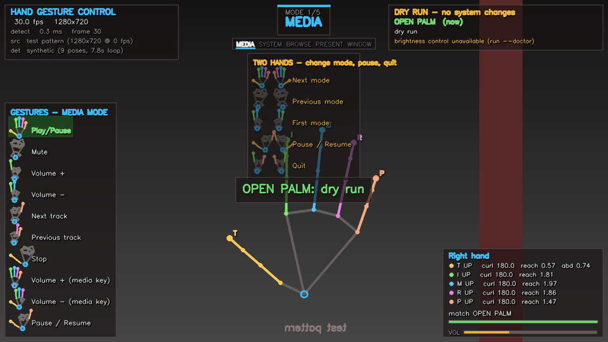
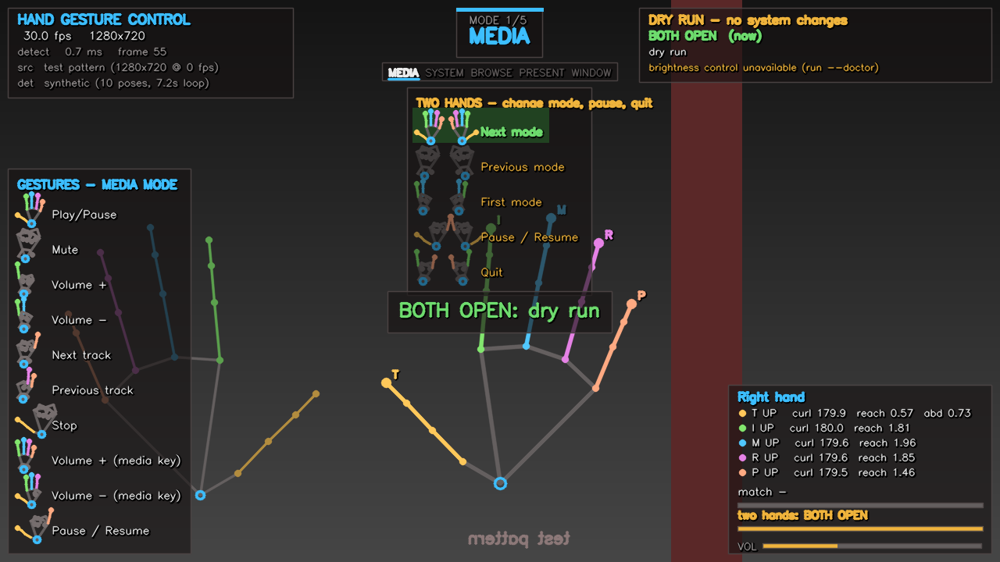

# gesture-control

Control your system volume, screen brightness and media keys with hand gestures
seen through a webcam. MediaPipe tracks the hands, a rotation-invariant geometry
layer decides which fingers are up, and a time-based state machine turns held
gestures into actions.

**Modes** are the central idea: the same hand shape does different things
depending on the mode you are in, and modes are changed with a **two-hand**
gesture so you can never do it by accident.

The HUD shows a **picture of each hand shape next to the plain name of what it
does**, for whichever mode you are in — so you never have to memorise a mapping
or decode a diagram.



---

## Reading the screen

Everything you need is on screen, and it follows the mode you are in.

**Top centre — where you are.** The mode badge (`MODE 1/5 MEDIA`) and a strip of
all five modes with the current one underlined, in that mode's accent colour.

**Under it — how to leave.** The two-hand gestures, drawn as two hands each,
with what they do: *next mode*, *previous mode*, *first mode*, *pause/resume*,
*quit*. These never change, because they are the controls for the thing that
changes.

**Bottom left — what you can do right now.** Every gesture in the current mode,
as a little picture of the hand beside the action it performs:

| | | |
|---|---|---|
| ✋ | Play/Pause | open palm |
| ✊ | Mute | fist |
| ☝ | Volume + | index |
| ✌ | Volume − | peace |
| 🤙 | Next track | thumb + little finger |

Switch to SYSTEM mode and the same table becomes *Brightness +*, *Show desktop*,
*Task view* — because those are what the same shapes do there.

**In the pictures:** a raised finger is drawn in its own colour, a folded one in
grey, and a finger the gesture *ignores* is drawn half-curled in the faintest
grey — so "this one does not matter" is visible rather than being another symbol
to learn. (The `classic` preset ignores the thumb, so its icons show a grey
half-curled thumb.)

**Bottom right — what the app sees.** Per-finger `curl`/`reach` numbers, the
gesture being matched, its arming progress, and live volume/brightness.

`--list-gestures` prints the same information in the terminal, also split by
mode, so the two views cannot disagree:

```
    make this shape    and it does                action
    ----------------------------------------------------------------------------
    OPEN PALM          Play/Pause                 key_play_pause
    FIST               Mute                       mute_toggle
    INDEX              Volume +                   volume_up
```



---

## Quick start

```bat
py -3.12 -m pip install -r requirements.txt
run.bat --doctor        :: check what this machine supports
run.bat --self-test     :: verify gesture recognition, no camera needed
run.bat                 :: run it
```

Or without the launcher:

```bat
python -m gesture_control --doctor
python -m gesture_control --list-modes
python -m gesture_control
```

> **If nothing happens, run `--doctor` first.** It reports the interpreter, every
> dependency, the camera, and each volume and brightness backend, with the actual
> reason for anything that failed.

**Requirements:** Python 3.9 – 3.12 (MediaPipe publishes no wheels outside that
range) and a webcam. `run.py` finds a suitable interpreter for you if the default
one cannot run this.

---

## Modes

Five modes ship by default, each with its own gesture table:

| # | Mode | What it controls |
|---|---|---|
| 1 | `MEDIA` | playback: transport, tracks, volume |
| 2 | `SYSTEM` | display, sound, windows |
| 3 | `BROWSE` | pages, tabs, history |
| 4 | `PRESENT` | slides: advance, back, blank the screen |
| 5 | `WINDOW` | windows, desktops, screenshots |

The same hand shape means different things in each:

| Shape | MEDIA | SYSTEM | BROWSE | PRESENT |
|---|---|---|---|---|
| ☝ index | volume + | brightness + | page down | next slide |
| ✌ peace | volume − | brightness − | page up | previous slide |
| 🤙 pinky | next track | volume − | next tab | end slideshow |
| 🤘 ring+pinky | previous track | volume + | previous tab | last slide |
| ✊ fist | mute | mute | select | blank screen |
| 🖐 open palm | play/pause | show desktop | top of page | start slideshow |
| 👍 thumb up | stop | task view | stop loading | first slide |

Every mode also contains the same **pause** gesture, so a pause is always
reversible from wherever you are.


### Switching modes needs both hands

| Two-hand gesture | Action |
|---|---|
| 🖐🖐 both palms open | next mode |
| ✊✊ both fists | previous mode |
| ✌✌ both V signs | back to the first mode |
| 🤙🤙 both shaka (thumb + little) | pause / resume |
| 🤘🤘 both horns (index + little) | **quit** |

Three things make these safe:

1. **They need two hands.** A two-hand gesture can never match a single hand, so
   no amount of one-handed gesturing can change mode or quit. This is asserted in
   the test suite, not just intended.
2. **They need a longer hold.** Two-hand gestures are armed over 0.55 s versus
   0.10 s for single-hand ones, so a shape that flashes past does nothing.
3. **They are checked before single-hand gestures.** If both hands are making a
   two-hand shape, no single-hand action fires, so a hand passing through a
   one-hand shape on its way into a two-hand pose cannot trigger anything.

There is also a half-second **settle window** after a mode change: the pose you
used to switch is not immediately re-read against the new mode's table, which
would otherwise fire the new mode's action for the same shape in the same moment.

---

## Everything else

**Hotkeys** (preview window focused):

| Key | Effect |
|---|---|
| `q` / `Esc` | quit |
| `p` **or** `space` | pause / resume |
| `n` / `.` | next mode |
| `b` / `,` | previous mode |
| `h` / `/` | first mode |
| `m` | toggle dry-run (recognise, change nothing) |
| `d` | toggle the detailed per-finger readout |
| `s` | save a screenshot |
| `r` | reset temporal state if a gesture ever feels stuck |

**Pausing is escapable by gesture.** This was a bug in an earlier version: pausing
suppressed every gesture, including the one that resumes, which left the keyboard
as the only way out of a state you entered to *avoid* the keyboard. Now each
mode's shaka shape (and `p`) toggles the pause, and the HUD says so on screen:

```
PAUSED - gestures ignored.  Resume: shaka shape (thumb + little) on BOTH hands, or press P
```

Holding the pause shape does not flip-flop: a one-shot gesture fires once per
hold, so you must release and repeat it to toggle again.

---

## Gesture reference

```
name             action             thumb idx mid ring pinky   label
------------------------------------------------------------------------
[1/5] MEDIA
play_pause       key_play_pause       ^    ^   ^   ^    ^      OPEN PALM
mute             mute_toggle          v    v   v   v    v      FIST
volume_up        volume_up            v    ^   v   v    v      INDEX
volume_down      volume_down          v    ^   ^   v    v      PEACE
next             next_track           v    v   v   v    ^      PINKY
prev             previous_track       v    v   v   ^    ^      RING+PINKY
stop             stop_media           ^    v   v   v    v      THUMB UP
media_vol_up     media_volume_up      v    ^   ^   ^    ^      FOUR
media_vol_down   media_volume_down    ^    ^   ^   ^    v      CLAW
pause            pause_toggle         ^    v   v   v    ^      PAUSE
...
TWO-HAND gestures
mode_next        mode_next            ^ ^ ^ ^ ^  +  ^ ^ ^ ^ ^ BOTH OPEN
mode_prev        mode_prev            v v v v v  +  v v v v v BOTH FISTS
mode_home        mode_home            v ^ ^ v v  +  v ^ ^ v v BOTH PEACE
pause            pause_toggle         ^ v v v ^  +  ^ v v v ^ BOTH SHAKA
quit             quit_app             v ^ v v ^  +  v ^ v v ^ BOTH HORNS
```

`^` = the finger must be up, `v` = it must be down. Print the live version with
`python -m gesture_control --list-gestures`, and just the modes with
`--list-modes`.

**Hold to repeat.** Volume, brightness and navigation gestures repeat while held:
one step immediately, then a continuous ramp after a short delay. A quick gesture
is a single step. Mode changes, track skips, space and quit fire once per hold.

Presets: `pro` (default, five modes), `classic`, `media`, `minimal`, `present`.

```bat
python -m gesture_control --list-presets
python -m gesture_control --preset classic     :: the original script's mapping
```

---

## Configuration

Everything is TOML. `--print-config` writes the effective configuration, so it is
always a valid starting point:

```bat
python -m gesture_control --print-config > my-config.toml
python -m gesture_control --config my-config.toml
```

`config.example.toml` is that output with explanatory comments. Precedence is
**defaults → `--preset` → config file → command-line flags**.

An unknown key is a **hard error** naming the valid ones, rather than being
silently ignored — a misspelled `repit_interval` cannot quietly do nothing here.

The sections that matter most:

```toml
[camera]
index = 0            # try 1 if 0 is the wrong camera

[detector]
max_hands = 2        # two, or two-hand gestures cannot work
model_complexity = 1 # 0 is marginally faster, 1 is more accurate
stride = 1           # detect every Nth frame; the real CPU lever

[smoothing]          # One Euro filter: steadier landmarks, no added lag
min_cutoff = 1.1     # lower = smoother at rest
beta = 0.035         # higher = tracks fast motion more closely

[tracking]
arm_seconds = 0.10            # single-hand hold before it fires
release_seconds = 0.12
two_hand_arm_seconds = 0.55   # two-hand hold; deliberately much longer
two_hand_release_seconds = 0.30
repeat_initial_delay = 0.45
repeat_interval = 0.12

[switching]
start = "media"                    # mode to start in
wrap = true                        # next mode past the last wraps to the first
settle_seconds = 0.5               # ignore single-hand gestures after a change
allow_while_paused = true          # mode switching works while paused
primary_hand = "right"             # whose hand drives single-hand gestures
single_hand_with_two_visible = "primary"   # primary | suppress | both

[actions]
volume_step = 0.05
brightness_step = 8
dry_run = false
allow_keyboard = true              # false = volume/brightness only
require_focus_title = ""           # only send keys while this window is focused

[thresholds]         # retune for your hand; the HUD shows the live values
finger_curl_up = 150.0
finger_curl_down = 120.0
finger_reach_up = 1.15
finger_reach_down = 0.95
```

Defining your own mode:

```toml
[[modes]]
name = "music"
label = "MUSIC"
accent = "ok"                # HUD colour: accent, ok, warn, index, thumb

[[modes.gestures]]
name = "volume_up"
action = "volume_up"
requirements = "thumb:down,index:up,middle:down,ring:down,pinky:down"
label = "INDEX"
repeatable = true
```

Anything can be bound to any action from `--list-actions`; a name that does not
exist is a startup error listing the valid ones.

### Retuning the thresholds

Thresholds are calibrated against a synthetic hand model, so they are a good
starting point rather than a guarantee for every hand and camera. The HUD shows
the live numbers per finger, which is what makes retuning practical:

```
I UP   curl 179.9  reach 1.81     <- comfortably extended
M down curl  71.3  reach 0.73     <- comfortably curled
```

`curl` is the angle at the finger's own joint in degrees (~180 straight, ~65
closed). `reach` is how far the fingertip projects along the palm axis, in palm
lengths. A finger between the two thresholds keeps its previous state, which is
what stops a hand resting near a threshold from flickering.

The gesture vocabulary uses **fully specified** shapes (all five fingers pinned).
That is stricter than the `classic` preset's forgiving `thumb:any`, and it is
what makes ambiguity structurally impossible: two different complete shapes must
disagree about some finger, so no two gestures in a mode can both match one hand.

---

## What changed

A summary of the defects in the original script and what replaced them.

### Recognition

| Original | Problem | Now |
|---|---|---|
| `lm[tip].y < lm[pip].y - 0.02` | Not rotation invariant: tilt your hand and a straight finger reads as curled. The `- 0.02` is in normalised units, so it changes meaning with distance. | Two hand-relative metrics: the joint angle at the finger, and the fingertip's reach along the palm axis. Verified invariant under rotation, scale and aspect ratio. |
| `lm[4].x < lm[3].x` for the thumb | Describes which way the hand faces, not whether the thumb is out. | Thumb extension needs *both* straightness and abduction. Neither alone works: a folded thumb measures as more "abducted" than a thumbs-up. |
| Raw normalised `x`/`y` compared | Normalised `x` is divided by frame *width*, `y` by *height*, skewing every angle by the aspect ratio. Measured on a curled, tilted finger: **43.7° at 4:3 vs 89.8° at 21:9** — a 46° swing across any sane threshold. | Landmarks convert once, at the detector boundary, into aspect-corrected metric space. The same measurement is 65.0° at every aspect ratio. |
| `check_fingers()` all-or-nothing | Required every unnamed finger to be *down*, including the thumb, so "index up" failed whenever the thumb drifted. | Three-state requirements per finger: up, down, or **ignored**. |
| No smoothing | Landmarks jitter, so states flickered near a threshold. | One Euro filter, one per hand: heavy smoothing at rest, low lag in motion. |
| No hysteresis | A finger on a threshold flipped every frame and machine-gunned actions. | Separate up/down thresholds; in between, the previous state is kept. |
| One hand only | No way to make a gesture that is safe from accidental triggering. | Two-hand gestures, with their own longer arming time, gating mode changes and quit. |

### Timing and actions

| Original | Problem | Now |
|---|---|---|
| `gesture_history` only appended when a gesture was detected | `None` frames never reset it, so a partially-completed run interrupted by a dropout still counted toward the next one. | The debouncer tracks how long *this* gesture has been visible and restarts when it changes. A regression test pins the old behaviour down. |
| 3 consecutive frames | Frame-count based, so 3 frames is 0.1 s at 30 fps and 0.5 s at 7 fps. | Time-based arming, frame-rate independent. |
| One global `last_action` with a 1 s delay | Every action locked out every other for a second, and holding a gesture could never repeat — 20 %→80 % volume took six separate gestures. | Per-gesture cooldown, plus hold-to-repeat. |
| Actions run inline in the frame loop | A brightness change is a WMI round trip of hundreds of milliseconds, which visibly stutters the preview. | System actions run on a worker thread with per-action coalescing. Application controls (pause, mode, quit) run inline, because they mutate state the frame loop owns. |
| No dry-run | Testing a mapping meant actually changing your volume. | `--dry-run` (or `m`) guarantees no system change; the registry never calls the action. |
| Key synthesis with no guard | A gesture types into whatever window is focused. | Optional focus guard (`--require-focus`) and `--no-keyboard`. |
| No pause at all | — | A pause that is reversible by gesture and says how on screen. |

### Robustness and diagnostics

| Original | Problem | Now |
|---|---|---|
| `cap.release()` only after a clean exit | An exception left the camera locked until the process died. | `try/finally` releases the source, closes the detector and destroys the window on every exit path. |
| `if not success: break` | A dropped frame ended the session. | Reopen with backoff, then a clear error. |
| No camera check | A camera that would not open exited silently. | An explanation with the index and the likely causes. |
| `hands.close()` never called | The MediaPipe graph was never released. | Closed in the shutdown path. |
| No FPS or state readout | Nothing to diagnose with. | A layered HUD: mode, mode list, per-mode gesture legend, two-hand controls, per-finger numbers, arming progress, live levels, and the last action's outcome including failures. |
| Hand-written gesture legend, and a `v ^ v v v` diagram | Could drift out of sync with the recogniser, and required you to know which column was which finger and what the symbols meant. | A picture of the hand shape drawn *from the same model the tests use*, beside the plain name of the action, for whichever mode is active. |
| No modes | Every gesture had to mean exactly one thing. | Five modes, switched with two-hand gestures, each with its own table — and the table on screen follows the mode. |

### The brightness bug

`screen_brightness_control` **fails on every backend** on the machine this was
developed against, and the error it raises is actively misleading:

```
RuntimeError: generator didn't stop after throw()
```

Its Windows path retries inside a `@contextmanager` that `yield`s twice, which is
illegal for a generator being thrown into — so the real error
(`WmiMonitorBrightness` does not exist) is replaced by the contextlib complaint.
The original script caught this, printed it, and carried on: the brightness
gestures could never work and nothing said why.

This version probes three independent backends and reports what each said:

```
[WARN] brightness backend: screen_brightness_control  RuntimeError: generator didn't
       stop after throw() -- this is an sbc bug that masks the real cause; try
       'pip install wmi', or use the wmi backend
[WARN] brightness backend: dxva2    the display does not report brightness over
       DDC/CI; common for internal panels and remote sessions
[WARN] brightness backend: wmi      WMI reported 0x80041003: WMI access was denied;
       the class may be absent, or WMI permissions may restrict it
[WARN] brightness control           no working brightness interface was found
       -> this is common on desktops, external monitors without DDC/CI, and remote
          sessions. Brightness gestures will report 'unavailable' instead of
          failing opaquely. Everything else works.
```

Backends are tried in order — `screen_brightness_control`, then DDC/CI through
`dxva2.dll` (no dependency), then the `WmiMonitorBrightness` WMI class via
PowerShell — and the first that works is used. Probing is strictly read-only;
`SetMonitorBrightness` is only reached after a successful read, so a capability
check can never change your screen.

Volume has a matching fix: `pycaw` 20181226 (installed here) returns a bare
`IMMDevice` from `GetSpeakers()`, while newer releases expose an `EndpointVolume`
property. Both are supported, and the interface is re-acquired if the default
output device changes (headphones plugged in).

---

## How it works

```
                 ┌─────────────── both hands ───────────────┐
camera ─► detector ─► per-hand ─► per-hand ─► two-hand  ─┐   │
 (thread) (MediaPipe) smoothing     pose       gestures   │   │
                                   hysteresis  (own        │   │
                                                debouncer) │   │
                                          │                │   │
                                          └─► single-hand ─┘   │
                                              gestures         │
                                              (current mode)   │
                                                  │            │
                                                  ▼            ▼
                                            debouncer ─► actions ─► system
                                                  │       (worker thread)
                                                  └──► HUD
```

Everything except the detector and the overlay is pure logic, which is why the
test suite can verify the recogniser without a camera:

| Module | Responsibility |
|---|---|
| `geometry.py` | Rotation- and scale-invariant measurements. |
| `pose.py` | Landmarks → five up/down states, with calibrated thresholds and hysteresis. |
| `gestures.py` | Single-hand gesture specs and tri-state finger requirements. |
| `modes.py` | Modes, mode switching, and two-hand gestures. |
| `vocabulary.py` | The named hand-shape vocabulary and the per-mode tables. |
| `icons.py` | Hand-shape pictograms for the legend, built from the same model as the tests. |
| `tracking.py` | The state machine: arming, releasing, repeating, cooldowns. |
| `smoothing.py` | One Euro landmark filter, one instance per hand. |
| `detector.py` · `sources.py` | MediaPipe and synthetic detection; camera, file and test sources. |
| `actions/` | Backends, registry, off-thread executor, application controls. |
| `overlay.py` | The HUD. Pure drawing, no control state. |
| `app.py` | Wiring and the frame loop. |
| `diagnostics.py` | `--doctor` and `--self-test`. |
| `synthetic.py` | The parametric single- and two-hand model that makes verification possible. |

### Why the synthetic hand model matters

`synthetic.py` builds hands from anatomical proportions: each phalanx is curled by
*measuring which fold direction brings the fingertip into the palm*, then the
whole hand is rotated and scaled. Because the pose is constructed in the hand's
own frame and rotated afterwards, a hand at 90° is geometrically identical to one
at 0° — so a recognition failure under rotation is a genuine bug, not a fixture
artefact. Two-hand poses are built the same way, mirrored so the pair reads as a
left and a right hand.

That model is what lets `--self-test` assert rotation and scale invariance for
every gesture in every mode, plus the safety property that **one hand never
satisfies a two-hand gesture**.

### Performance

Measured on a typical CPU:

- MediaPipe inference is **~20–25 ms per frame** and essentially **independent of
  input resolution**, because MediaPipe resizes to 224×224 internally: 20.2 ms at
  1280×720 and 20.8 ms at 480×270. `detector.downscale_width` therefore buys
  almost nothing, and `detector.stride` is the real lever. (The option is kept and
  documented honestly rather than removed, in case a particular machine's
  bottleneck is the colour conversion.)
- The camera is read on a background thread that keeps only the newest frame, so a
  slow inference pass cannot make the preview drift progressively behind. `read()`
  blocks until a genuinely new frame arrives, which paces the loop to the camera
  instead of spinning.
- System level readouts are cached and refreshed on a timer: querying volume is a
  COM round trip and brightness can be a WMI round trip.
- Two hands cost no extra inference. MediaPipe's palm detector finds both hands in
  the same pass; `max_hands = 2` only changes how many are reported.

---

## Command line

```
python -m gesture_control [options]

Modes (exit immediately)
  --doctor              check the interpreter, dependencies, camera and backends
  --self-test           verify every gesture in every mode, one hand and two
  --print-config        print the effective configuration as TOML
  --list-presets        list gesture presets
  --list-gestures       list every mode and its gestures
  --list-modes          list modes and the two-hand gestures that switch them
  --list-actions        list actions and backend capabilities

Input
  --camera N            camera index                  --source camera|test|file
  --video PATH          for --source file             --no-mirror
  --detector auto|mediapipe|synthetic                 --stride N
  --width N --height N --fps N

Output
  --no-window           no preview window             --max-frames N
  --save-frames DIR     write rendered frames         --save-every N
  --overlay-scale S

Tuning
  --mode NAME           mode to start in
  --dry-run             recognise but never act        --sync-actions
  --no-keyboard         disable key synthesis          --require-focus TITLE
  --no-smoothing --min-cutoff HZ --beta B
  --arm-seconds S --release-seconds S
  --repeat-delay S --repeat-interval S
  --volume-step F --brightness-step N
  --config PATH --preset NAME --log-level LEVEL --debug
```

`--source test --detector synthetic` runs the complete pipeline against a scripted
hand with no camera at all, which is how the screenshots above and the integration
tests are produced:

```bat
python -m gesture_control --source test --detector synthetic --dry-run ^
    --no-window --max-frames 280 --save-frames frames --save-every 20
```

---

## Testing

The suite uses only the standard library's `unittest`, so it runs with no extra
install:

```bat
python -m unittest discover -s tests -t .
python -m gesture_control --self-test
```

375 tests, covering among other things:

- **geometry** — rotation, scale and aspect-ratio invariance across 8 rotations, 5
  hand sizes and 3 aspect ratios; the aspect-ratio bug quantified.
- **pose** — every gesture shape, all 16 subsets of the four long fingers, the
  three thumb cases a "is it straight" test cannot separate, and hysteresis
  stickiness *and* its refusal to freeze a real transition.
- **modes** — mode containers and switching, hand-shape vocabulary consistency,
  two-hand matching including handedness tolerance, and the central safety
  property: **one hand is never enough for a two-hand gesture**.
- **legend** — that the on-screen table plans a grid holding *every* gesture in
  the mode without overflowing, that its width is measured from the action names,
  that changing mode changes the render, that the same shape is labelled
  differently per mode, and that the pictograms mark raised fingers in their own
  colour.
- **tracking** — arming, release tolerance, repeat cadence at three frame rates,
  no burst after a stall, cooldowns, and a regression test for the original's
  stale-history bug.
- **actions** — failure isolation, dry-run airtightness, off-thread execution,
  coalescing, that only one action runs at a time, and that application controls
  run *inline* rather than being offloaded.
- **sources** — the camera pacing contract: each frame returned once, `read()`
  blocking rather than spinning, and `close()` waking a blocked reader.
- **app** — end-to-end runs with a virtual clock: gesture sequence to action,
  two-hand mode switching, two-hand quit, gesture-driven pause and resume, that a
  brief flash of the quit shape does nothing, and that a single dropped frame does
  not cancel a hold.
- **overlay** — rendering at three resolutions plus tiny frames, every state
  combination, and that an extended finger is drawn in its colour.
- **diagnostics / CLI** — the doctor never raises, the self-test *can* fail, and
  every override flag defaults to `None` so it cannot clobber a config value.

`--self-test` is the same machinery applied to your own configuration: every
gesture in every mode, at five rotations and three hand sizes, plus the two-hand
cases and the one-hand negative case.

```
[PASS] media/volume_up        15/15 cases
[PASS] two-hand/quit          13/13 cases
...
766 cases: 766 passed, 0 failed
```

---

## Troubleshooting

**"No module named 'mediapipe'" (or 'cv2') on Windows**

You have more than one Python and the dependencies are in a different one. This
is by far the most common failure. `run.py` handles it automatically, and
`--doctor` shows which interpreter is running and what is installed in it.

**The camera will not open**

`--doctor` reports this specifically. Usually another application is holding the
device (close Teams/Zoom/OBS), Windows camera privacy settings are blocking it,
or you want `--camera 1`. Camera access is typically unavailable in a remote
desktop session.

**Mode switching does nothing**

It needs **both** hands visible and held for about half a second. Check
`detector.max_hands` is 2 and that both hands are in frame. `--list-modes` prints
the exact shapes.

**Brightness gestures report "unavailable"**

That machine has no working brightness interface — no DDC/CI on the display and no
`WmiMonitorBrightness` WMI class. Normal on desktops, external monitors, virtual
machines and RDP sessions. Volume and keyboard gestures are unaffected.
`pip install wmi` fixes it where the WMI class exists but the package was missing.

**A gesture does nothing, or the wrong one fires**

1. `--self-test` confirms the gesture definitions are recognisable.
2. Press `d` for the detailed readout and check the per-finger numbers. If a
   finger you are holding up shows `down`, its `curl` or `reach` is outside the
   band — adjust `[thresholds]`.
3. `--list-gestures` shows the table for every mode. If the shape you are making
   is not in the current mode's list, that is working as configured — switch mode.

**Two hands in frame stop my single-hand gestures**

By default only the `primary_hand` counts while both are visible. Set
`switching.single_hand_with_two_visible = "both"` to use either hand, or
`"suppress"` for the most conservative behaviour.

**Keys go to the wrong window**

Inherent to synthesising keystrokes. Use `--require-focus "Window Title"` to gate
them, or `--no-keyboard`.

---

## Limitations

- **One primary hand for single-hand gestures.** Both hands are tracked, but with
  two visible only the configured primary hand drives single-hand actions. This is
  deliberate (see above) and configurable.
- **2D only.** MediaPipe's `z` is deliberately ignored: it is the least reliable
  axis and the geometry works without it.
- **Thresholds are calibrated on a synthetic model.** A sound starting point, not
  a per-user calibration. The HUD exists to make retuning practical.
- **Brightness depends on hardware.** No software fallback can work without driver
  support.
- **Modes are switched by gesture only.** There is no "press a key to jump to
  mode 3"; the keyboard can step and reset, not select arbitrary modes.

## License

MIT.
